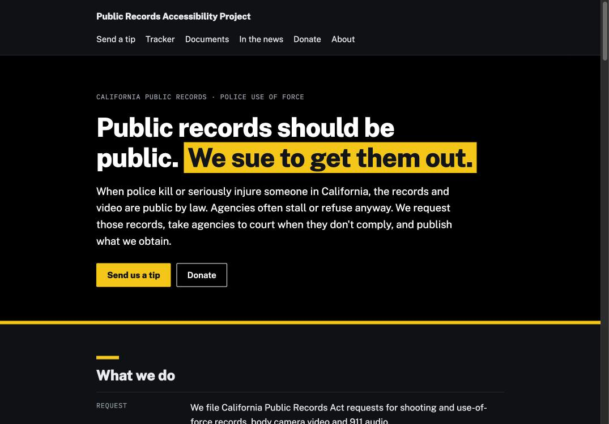

# Public Records Enforcement Project

Website for the Public Records Enforcement Project. The project files California Public Records Act requests and pro se lawsuits for police shooting and use-of-force records, then publishes what it obtains.

Founders: Yesica Prado and Robbie Powelson.

Live site: https://robbiepowelson-code.github.io/public-records-accessibility-project/



## What's here

- `index.html` is the home page: intro, what we do, and who we are.
- `authors.html` is the Authors page. To add someone, copy one `<article class="author">` block (instructions are in a comment at the top of the list).
- `styles.css` holds the styles shared by every page.
- `images/authors/` is where author photos go.
- `docs/screenshots/` has screenshots of the live site.

## Status

Early version. Only finished content is published. Planned additions, each to be added once it works:

| Feature | Options |
| --- | --- |
| Tip form | Formspree, Basin, Netlify Forms, or a Google Form |
| Newsletter | Buttondown, Substack, or Mailchimp embed |
| Donations | Fiscal sponsor's donation page, Givebutter, Donorbox, or Patreon |
| Request tracker, documents, press | Edit the page directly, linking to MuckRock and DocumentCloud |

## Publishing with GitHub Pages

Settings > Pages > Deploy from a branch > `main` / root. The site will appear at `https://<username>.github.io/public-records-accessibility-project/`.

## Run it locally

```
./start.sh
```

Then open http://localhost:8000 (it opens automatically on a Mac).
